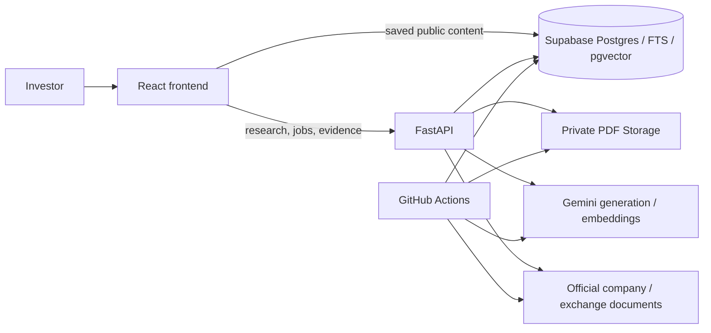

# FINN — Investor Intelligence & Evidence-Backed Research

**[Live demo](https://finn-web-yb14.onrender.com) · [GitHub repository](https://github.com/ash9201/enam_finn)**

Investors follow companies across exchange announcements, financial statements and
earnings calls. The difficult part is deciding what deserves attention and tracing an
interpretation back to the underlying disclosure.

FINN brings those tasks into one mobile-first research workspace. A watchlist briefing
surfaces company developments; research connects questions to exact primary-document
passages; financial comparisons keep their periods, definitions and source figures
visible. It was developed for the ENAM AI Engineer Build Challenge.

No account is required. The interface supports desktop and mobile, keyboard navigation,
and Light, Dark and System themes. The free API may need about a minute to wake after
idle time; the static frontend and saved public data load separately.

## Key features

- **Briefing:** prioritised NSE announcements across 15 companies, grouped into
  source-backed events or shown chronologically. Combine date, company, category,
  significance and review filters. Review an event, undo, and inspect every original
  filing. Configurable price/volume thresholds highlight unusual completed sessions.
- **Research:** find companies by name, symbol, alias or minor typo, with explicit
  selection for ambiguous matches. Explore business models, outlook and risks, quarterly
  results, management statements, or a company-scoped question.
- **Evidence inspection:** compact evidence buttons open the exact supporting passage,
  physical PDF page, document metadata and original link. Contextual follow-ups can
  search other reports and calls for repetition, later evidence or another perspective.
- **Financial analysis:** inspect Revenue, explicitly reported EBITDA, PBT and PAT,
  compare compatible quarters, and ask numerical questions. Each reported figure or
  calculated input retains its evidence; missing or ambiguous values stay unavailable.
- **Portfolio:** a sortable desktop watchlist and compact mobile presentation show
  last close, signed 1D change, volume signals and recent events, with direct Research
  and Briefing actions. These are share prices, not fictional investment returns.

## Tech stack and architecture

| Layer | Technology |
| --- | --- |
| Interface | React 19, TypeScript, Vite, Tailwind integration, shared CSS theme tokens |
| API and processing | Python 3.12, FastAPI, Pydantic, pypdf, PDFium, pdfplumber |
| Persistence and search | Supabase PostgreSQL, full-text search, pgvector, private PDF Storage |
| AI | Gemini `gemini-3.5-flash-lite`; `gemini-embedding-001` embeddings |
| Hosting and automation | Render static frontend and Python API; GitHub Actions |



Research resolves a verified company identity, discovers primary documents, extracts
page-aware evidence, retrieves relevant passages, then generates structured claims.
Validation binds claims to company-owned sources and stored quotations before returning
an answer. Persisted jobs expose progress; versioned caches reuse documents, answers
and embeddings without relabelling old information as fresh. Supabase keeps state
outside the API's ephemeral filesystem.

## Technical highlights

**Hybrid retrieval with an honest fallback.** PostgreSQL keyword search and pgvector
cosine similarity share company, document and metadata filters. Reciprocal Rank Fusion
combines rankings rather than incompatible raw scores. Semantic search is enabled
only for complete current company indexes; incomplete indexing, quota limits or
semantic failures preserve keyword retrieval. No separate vector database or RAG
framework is needed.

**Evidence is part of the interaction.** Follow-up context contains server-resolved
answer and citation references, rather than client-authoritative quotations. Later-evidence
investigations require independently dated later documents. Repeated guidance is not
treated as a delivered target. Exact-quote checks establish source presence, while
conservative validation and source review address support; they do not prove every
interpretation automatically.

**Financial correctness has a separate pathway.** Extraction preserves units,
accounting basis, reporting periods, row/column references and page provenance.
Bounded image recovery can corroborate damaged native statements. Decimal arithmetic
handles approved comparisons and ratios only after compatibility checks. Recognition
of a financial metric does not guarantee that suitable figures are available.

**Measured retrieval trade-offs.** A small seven-question positive reference-page set
across CCL and GOKEX measured Recall@5 of 0.571 for matched keyword search versus
0.929 for hybrid; Recall@10 was 0.857 versus 0.929. Warm median retrieval took
688 ms versus 1,881 ms with cached query vectors. These are limited engineering
measurements, not independent accuracy scores or production latency guarantees.
See [methodology and results](docs/HYBRID_EVALUATION.md).

## Data sources and updates

- **Announcements:** [NSE RSS](https://nsearchives.nseindia.com/content/RSS/Online_announcements.xml),
  with linked official NSE/BSE/company documents.
  Scheduled retrieval is configured every 30 minutes; captured history is not a
  complete exchange archive. A separate comprehensive BSE announcement feed is not implemented.
- **Market data:** unadjusted Yahoo Finance daily history, with matching NSE daily-file
  recovery for an incomplete latest returned bar. EOD refresh is configured for
  18:15 IST weekdays. Volume comparisons exclude the current session from their baseline.
- **Research documents:** Screener's document-link sections locate original annual
  reports and transcripts. Its generated commentary and financial tables are not
  research evidence. Acquisition and explicit source refresh happen on demand.
- **Indexing and caches:** daily quota-bounded embedding maintenance resumes existing
  corpora. Saved data retain original source and completion dates. Reloading saved
  updates does not trigger a fresh exchange fetch.

GitHub schedules can run late. The UI exposes actual freshness, failed scans and
recorded fallback labels. Historical documents and semantic coverage may be incomplete;
see [architecture](docs/PLAN.md) and [deployment](docs/DEPLOYMENT.md).

## Getting started

Open the **[live website](https://finn-web-yb14.onrender.com)**. Try INFY's business
overview, POLYCAB's **Quarterly results**, and CCL's **Track management statements**.
Open **View evidence**, then **Ask about this evidence** to investigate another document.
In Portfolio, sort by activity and jump to a company's Briefing. An unfamiliar NSE
company uses the same acquisition pipeline, subject to accessible documents.

For local development, use Python 3.12 and Node 24. Copy
[`.env.example`](.env.example) to `.env.local` and fill in Supabase and Gemini settings.
Keep privileged keys server-side. A new Supabase project also needs the repository's
SQL migrations before research can run.

```bash
python3.12 -m venv .venv
.venv/bin/python -m pip install -r requirements.lock
.venv/bin/python -m pip install -e '.[dev]'
npm --prefix frontend ci --no-fund --no-audit
.venv/bin/python -m uvicorn finn.main:app --host 127.0.0.1 --port 8000
# In another terminal:
npm --prefix frontend run dev
```

Open `http://localhost:5173`. Windows bootstrap, database provisioning, environment
variables and hosting instructions are in the [deployment guide](docs/DEPLOYMENT.md).

## Known limitations

Free-tier cold starts, provider quotas and source-access restrictions can interrupt
uncached research. Some filings are missing, scanned or difficult to extract; incomplete
periods, units or accounting bases block financial comparisons. Embedding coverage is
partial, with keyword research remaining available. The prototype has no user
authentication and is intended for public financial documents, not confidential data.
It does not provide live prices, trading, portfolio P&L or investment recommendations.

## Further documentation

- [Architecture and evidence workflow](docs/PLAN.md)
- [Hybrid retrieval](docs/HYBRID_RETRIEVAL.md) and [evaluation](docs/HYBRID_EVALUATION.md)
- [Financial extraction and numerical research](docs/QUARTERLY_RESULTS.md)
- [Deployment and local development](docs/DEPLOYMENT.md)
- [Testing and reliability](docs/EVALUATION.md)
- [Chronological build history](docs/BUILD_HISTORY.md)
