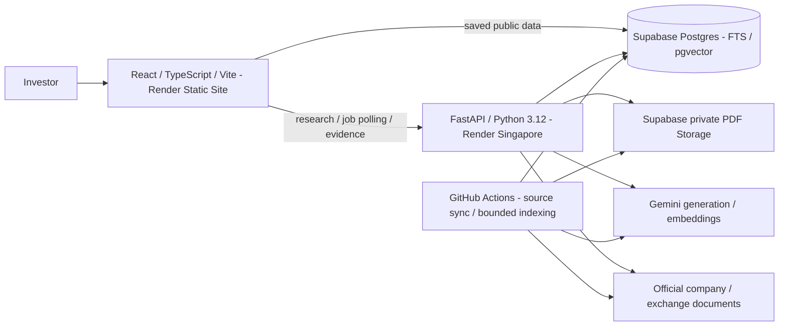

# FINN - investor attention and evidence-backed research

FINN is a mobile-first prototype for the ENAM AI Engineer Build Challenge. It helps
public-markets investors decide what deserves attention across a watchlist, then
investigate the company documents behind it without losing the source evidence.

| Try it | Link |
| --- | --- |
| **Website** | **https://finn-web-yb14.onrender.com** |
| API | https://finn-api-source-test.onrender.com |
| API liveness | https://finn-api-source-test.onrender.com/health/live |
| Public repository / deployment branch | https://github.com/ash9201/enam_finn / `main` |

No sign-in is required. Start with **Briefing**, **Company Research** and **Portfolio**.
The interface supports phones/desktops, keyboard navigation and Light/Dark/System themes.
Prices are individual share prices, not investment values or portfolio returns.

## Capabilities and scope

| Page | Investor workflow | Boundaries |
| --- | --- | --- |
| Briefing (**Push**) | Prioritised announcements grouped by company/event or chronologically; combined date/company/category/review filters; official sources; event review/undo; configurable unusual-price/volume alerts. | In-app, scheduled EOD information. No instantaneous exchange delivery or external notifications. Review receipts/thresholds are browser-local. |
| Research (**Pull**) | Search names, symbols, aliases or minor typos; select ambiguous matches explicitly; use four quick actions or free-text questions. Inspect passages and investigate repetition, later evidence or another perspective. | Generic NSE discovery, not a demo-company allowlist. Primary-document availability and validation determine what can be answered. |
| Portfolio | Fifteen companies; sortable desktop watchlist and compact mobile rows; last close, 1D change, genuine filing/price/volume indicators, Briefing/Research links. | Mock membership only: no holdings, purchase prices, P&L or trading. |

The watchlist is APLAPOLLO, BHARTIARTL, CCL, HDFCBANK, INFY, ITC, KPITTECH, LT,
M&M, NTPC, POLYCAB, RELIANCE, SUNPHARMA, TATASTEEL and TITAN. Full company names
appear in the UI. Prepared examples include INFY, POLYCAB and CCL. Prior cloud tests
acquired TCS, HINDUNILVR and GOKEX through the same pipeline; these now have saved
corpora, so reopening them demonstrates reuse, not fresh unfamiliar-company acquisition.

**Financial research:** quarterly results verify Revenue, explicitly reported EBITDA,
PBT and PAT from actual filings and calculate QoQ/YoY absolute/percentage changes.
Accounting basis, currency, units, periods, source cells and missing values remain
explicit. Basis controls appear where data exists. Observed changes are separated
from disclosed costs/settlements; those disclosures are not automatically causes.

Numerical questions use a deterministic registry of **147 metrics/aliases** and
**19 approved calculation paths**, conditional on compatible verified inputs. Common
leverage, liquidity, margins, growth, returns and cash-flow questions are supported.
EPS, EBITDA and CFO are reported-only. Many specialist/sector metrics are recognised
but support direct-disclosure attempts rather than calculations. Valuations must be
dated disclosures, not fabricated live ratios. See the
[actual support matrix and examples](docs/QUARTERLY_RESULTS.md).

**Management analysis:** compare an earlier assertion with independently dated later
evidence. Reviewed CCL/KPIT examples distinguish reaffirmation, revision, interim
progress and completed outcomes. This is statement-level investigation, not a complete
four-quarter guidance dashboard or a company-wide management score.

## Evaluator walkthrough

1. **Briefing:** choose 24 hours, seven days or a custom filing window. Open a company
   and event; inspect its explanation/sources; mark reviewed and undo. Routine filings
   remain available. **Alert thresholds** beside unusual activity change the defaults
   of +/-4% daily movement and 2x prior-20-session mean volume. Filing windows and EOD
   thresholds are separate controls.
2. **Research:** use **Find company** or **View all 15 companies**, then select a match.
   Try INFY's business overview, POLYCAB's **Quarterly results**, CCL's **Track management
   statements**, or TMCV's `debt to equity ratio`.
3. **Evidence:** prose is selectable text. **View evidence** opens the exact passage,
   document metadata and physical PDF page in FINN's drawer. The distinct **Open original
   document** link opens the external PDF. Missing dates say **Not established**.
   A temporary verification failure retains labelled saved evidence with a retry;
   failed verification cannot support a follow-up.
4. **Investigate:** **Ask about this evidence** preserves company/claim/source context
   while retrieving other documents. Remove context to return to general research.
   Unsupported chronology or target delivery is explicitly not assessable.
5. **Portfolio:** sort by company, 1D change or activity, expand a row, inspect the common
   market-data date and **Data sources / Methodology**, then open related Briefing or
   Research. No alerts is meaningful only alongside coverage/freshness information.

An unfamiliar ticker uses the same generic resolver/discovery pipeline. Initial
acquisition can take minutes or fail for unavailable documents. Cached answers,
older reports, weekend sessions and recorded snapshots retain their original dates.

## Architecture and design decisions



- **Client/API:** React 19, TypeScript, Vite, Tailwind integration and shared CSS tokens;
  FastAPI/Pydantic with persisted jobs and polling. Public saved content can load without
  waking Python. Acquisition and prepared-answer work have bounded workers. PDFs/results
  persist outside Render's ephemeral filesystem. No separate vector service or agent framework.
- **Retrieval:** company/document/date/metadata filters apply to PostgreSQL full-text
  and pgvector cosine search. Gemini produces 768-dimensional normalised vectors.
  Reciprocal Rank Fusion uses 30 candidates per branch, 10 results, k=10, semantic weight
  2 and page/document diversity. Complete current company indexes are required; incomplete
  indexes, unavailable quotas/providers/semantic SQL or unusable semantic matches preserve
  the keyword path. [Design](docs/HYBRID_RETRIEVAL.md), [evaluation](docs/HYBRID_EVALUATION.md).
- **Grounding:** retrieve before generation; validate structured claims, identifiers
  and source quotations. Whitespace repair returns an original source slice. Sources
  retain hashes, original/final URLs, fetch times and pages. General LLM output cannot
  invent financial table figures/ratios. Quote existence alone does not prove semantic
  support; reviewed examples and conservative abstention supplement automated checks.
- **Financial extraction:** pypdf/PDFium/pdfplumber preserve layout/reading text and table
  candidates. Candidates are not approved facts. Quarterly extraction can use bounded,
  cached independent image reads with agreement checks. Numerical research reuses approved
  cells and native evidence; Decimal calculations enforce entity, period, currency, unit
  and basis compatibility. TMCV/TMPV are distinct; historical demerger recasts are not inferred.
- **Caching:** relevant source/document hashes, scope, model/prompt/extraction/calculation
  versions and evidence context key results. Embeddings are task/model/version/input-hash
  cached and incrementally backfilled. A cached Research POST can still write a job and
  schedule indexing; the submission checker deliberately uses GETs/read-only cache functions.

### Current indexing and measured trade-off

Read-only inventory on **3 November 2026**: **3,299 / 20,028 current chunks**,
**17 / 75 current documents**, **21 companies with collected documents**.
CCL (707/707), GOKEX (711/711) and V2RETAIL (25/25) are complete/hybrid eligible.
INFY (877/1,160), TMCV (811/1,208), POLYCAB and other incomplete companies retain
keyword retrieval. Counts change as documents arrive and quota permits indexing.
This is not a fully embedded NSE universe. [Dated rollout](docs/HYBRID_ROLLOUT.md).

The frozen seven-positive CCL/GOKEX reference-page set measured Recall@5/10 of
0.5714/0.8571 for matched keyword and 0.9286/0.9286 for hybrid. Warm median retrieval
was 688 ms versus 1,881 ms from this workspace with cached query vectors. This small
set supports the trade-off, not a broad accuracy claim, production latency guarantee
or new generated-answer-quality evaluation.

## Data sources and refresh behaviour

GitHub can delay cron starts. The UI shows actual completion and trading-session dates.
The table traces repository code/workflows; it does not imply real-time market updates.

| Source / information | Website use | Automatic / on-demand refresh | Cache and failure behaviour |
| --- | --- | --- | --- |
| [NSE announcement RSS](https://nsearchives.nseindia.com/content/RSS/Online_announcements.xml): dated disclosures | Briefing and Portfolio filing activity | [Source workflow](.github/workflows/portfolio-sync.yml), `17,47 * * * *` UTC: every 30 minutes. No Gemini key. | Recent RSS plus history captured since 30 October; not a complete archive. Failed/partial scans are visible. Routine filings stay accessible. |
| Official linked NSE/BSE/company filings and feed details | Event explanations and individual official sources | Same source run enriches up to six pending filings; deterministic classification/extraction, including contextual credit-rating actions. | Cached source excerpts retain filing identities. Missing documents remain limited. BSE is a document host, not a separate comprehensive monitored announcement feed. |
| Yahoo Finance / `yfinance`: three months of unadjusted daily prices, volumes and splits (`.NS`) | Portfolio last close / 1D change; EOD alerts | `45 12 * * 1-5` UTC: **18:15 IST weekdays**. Current-day bars only accepted after the 18:00 IST completeness cutoff. | Needs 21 valid completed-session bars; previous 20 exclude current. Bounded throttling retry. Persistent failure retains dated data with errors. Split-affected comparisons are suppressed. |
| [NSE UDiFF daily bhavcopy](backend/finn/price_primary.py): exact-date close, volume, previous close | Recovery of an incomplete latest returned Yahoo bar | During EOD retrieval only when that returned bar has incomplete close/volume; validates EQ series, date and symbol/ISIN. | Explicit NSE provenance; bounded archive cache. Does not invent a missing historical baseline or silently substitute older sessions. Newer saved sessions cannot be overwritten by older responses. |
| [Official NSE equity directory](https://nsearchives.nseindia.com/content/equities/EQUITY_L.csv), durable/bundled verified snapshots and resolved identities | Name/symbol/alias/typo selection and company/ISIN validation | Source workflow invokes refresher each run; internal guards attempt an official refresh at most daily when due. Backend snapshot cache: 15 minutes; browser memoises for its page lifetime. | Last-known-good dates/provenance survive 403s/outages. Known companies do not require live NSE per question. Browser uses public reference Storage then bundled official capture. New/unresolved listings can wait for a successful refresh; no invented identities. |
| Screener's **document-link sections only**; original official annual reports/transcripts | General Research, outlook/risks, management comparisons | On demand for a new company or explicit **Check latest sources / Refresh sources**. Normal reuse initially targets one annual report/two transcripts; **Add earlier documents** requests two/four where available. | No scheduled whole-market report crawl. Versions are content-hashed. Failed refresh is explicit; old documents stay saved without becoming a successful refresh. Screener commentary/tables, broker notes, news and model-memory company facts are not Pull evidence. |
| Actual official quarterly-results PDFs | Quarterly comparisons and numerical evidence | On demand; valid quarterly answer caches have a **24-hour reuse window**, not an automatic daily results refresh. | Period/basis/units/page references preserved. Missing EBITDA or ambiguous/incompatible figures stay unavailable. Bounded image recovery is not comprehensive OCR. |
| Gemini `gemini-3.5-flash-lite` | Grounded explanations/claims, bounded quarterly text/image extraction, reviewed management comparisons | On demand with usage accounting and versioned caches. | Bounded retries/reservations; explicit quota/time-out errors. No fabricated replacement. `GEMINI_REASONING_MODEL=gemini-3.8-flash` is retained configuration, not the model used for current comparisons. |
| Gemini `gemini-embedding-001` + Supabase pgvector | Semantic search alongside keyword retrieval | Missing query vectors on demand; incremental document indexing on corpus activation/reuse and [daily maintenance](.github/workflows/embedding-maintenance.yml) at **08:45 UTC / 14:15 IST**. | Owner-reported quota: 100 RPM / 30k TPM / 1,000 daily inputs. App uses lower budgets (bulk 850, foreground 900), caches and stop/resume. Incomplete/failed semantic work preserves keywords. |
| Supabase saved public data and private documents/jobs/caches; dated bundled snapshot | Fast first screen, persistence and explicit recovery | Briefing/Portfolio reread saved data on activation and every **60 seconds while visible**. **Reload saved updates** rereads storage; it does not fetch NSE/Yahoo. | A read outage can show a clearly labelled recorded snapshot with original dates. Failed uncached research never silently becomes a canned answer. |

Successful scheduled source/indexing runs on `main` were checked. Both Supabase
fallback schedules (`finn-filings`, `finn-eod-prices`) were verified inactive on
3 November. They are recovery options, not a second active scheduler. Operators can
dispatch the source workflow/CLI; the public reload button is not an ingestion trigger.
At the 3 November 14:25 IST check, the latest completed filing scan was 08:09 IST;
an on-time half-hour cadence was not observed. Check displayed freshness and use an
existing manual workflow dispatch if a newer pre-demo scan is needed. No scheduler
or infrastructure was changed to conceal this gap.

## Deployment and Free plans

On **3 November**, the owner confirmed the active Singapore API is still Render **Free**,
the frontend is a **Render Static Site**, Supabase is **Free**, and Gemini uses the free
quota. These are owner-confirmed dashboard settings; public endpoints/repository checks
cannot independently audit billing entitlements. `render.yaml` specifies Free Python
hosting. The active API service is named **`finn-api-source-test`** for historical reasons.

[Render documents](https://render.com/docs/free) that a Free web service spins down
after about **15 idle minutes** and wakes on the next request, taking roughly **one
minute**. Its static-site CDN does not share that Python-process cold start. Open the
website normally, allow the first API request to wake it, and retry if necessary.
If the API is awake but the browser blocks it, check site-specific content-blocking
rules and the configured CORS origin; never expose server keys to bypass an error.
`/health/live` confirms process availability/revision; `/health/ready` reports settings,
**not** successful live dependency checks.

Free bandwidth/build/instance allowances, Supabase capacity or inactivity pauses,
Gemini quotas and upstream access restrictions can affect the demo. Stored data survives
API restarts in Supabase. No paid upgrade or artificial keep-alive traffic is required.
Normal pushes to existing `main` deploy the linked services; preserve their current
environment/CORS settings. Verify the API revision and actual frontend build rather
than just a successful push. [Deployment/recovery guide](docs/DEPLOYMENT.md).

## Local setup

Prerequisites: Python **3.12**, Node **24**, Supabase and Gemini access. Create root
`.env.local` from `.env.example` **only if it does not already exist**. Never commit keys.

### Windows x64 portable toolchain

```powershell
py -3.12 scripts/bootstrap.py
.\.venv\Scripts\python.exe -m uvicorn finn.main:app --host 127.0.0.1 --port 8000
# Second terminal, repository root:
.\.venv\Scripts\python.exe scripts/npm.py run dev
```

The bootstrap verifies Node's download hash and installs workspace-local tools without
changing system PATH/execution policy. For locked Python reproduction use `requirements.lock`.

### Existing toolchains / Linux / macOS

```bash
python3.12 -m venv .venv
.venv/bin/python -m pip install -r requirements.lock
.venv/bin/python -m pip install -e '.[dev]'
npm --prefix frontend ci --no-fund --no-audit
.venv/bin/python -m uvicorn finn.main:app --host 127.0.0.1 --port 8000
# Second terminal:
npm --prefix frontend run dev
```

Open `http://localhost:5173`: `/` is Briefing, `/?view=research` Research,
`/?view=portfolio` Portfolio, `/?view=status` secondary System Status.
`/?view=foundation` is a compatibility alias, not the evaluator entry point.

| Root environment variable | Purpose |
| --- | --- |
| `SUPABASE_URL`, `SUPABASE_SECRET_KEY`, `SUPABASE_PUBLISHABLE_KEY` | Project URL, **server-only** secret and intended public key. Supported legacy/public aliases are documented in `.env.example`. |
| `GEMINI_API_KEY` | Server-only generation/embedding access. |
| `GEMINI_LITE_MODEL`, `GEMINI_REASONING_MODEL`, `GEMINI_EMBEDDING_MODEL` | Exact defaults/roles listed in the source table above. |
| `FINN_ENABLE_SEMANTIC_SEARCH` | Production `true`; new unprepared DB/keyword rollback `false`. |
| `SUPABASE_STORAGE_BUCKET` | Private PDF bucket, default `finn-documents`. |
| `FINN_ALLOWED_ORIGINS` | Exact frontend origins; local default `http://localhost:5173`. |
| `VITE_API_BASE_URL`, `VITE_SUPABASE_URL`, `VITE_SUPABASE_PUBLISHABLE_KEY` | Public frontend settings; Vite can derive public Supabase values from root settings. |
| `FINN_DEPLOYED_API_URL`, `FINN_DEPLOYED_WEB_URL` | Optional read-only deployment-check targets. |

Secrets must never have `VITE_`/`NEXT_PUBLIC_` prefixes. Vite exposes only public values.

### New database (operators, not evaluators)

Apply `supabase/migrations/0001_...sql` through `0011_...sql` in numeric order through
Supabase SQL Editor, keeping **RLS enabled**. Use current files in full. Raw PDFs,
pages/chunks, private answers, jobs, vectors and usage accounting are restricted;
anonymous database reads expose only intended watchlist/briefing/published outputs.

```powershell
.\.venv\Scripts\python.exe -m finn.ingest --portfolio
.\.venv\Scripts\python.exe -m finn.ingest --symbol INFY --publish
# Verify one company, then prepare POLYCAB and CCL the same way.
.\.venv\Scripts\python.exe -m finn.briefing --mode all
```

These are real provisioning/acquisition commands, not unit tests; existing deployments
do not need reseeding. Source Actions need secrets `SUPABASE_URL`/`SUPABASE_SECRET_KEY`
and variable `FINN_ENABLE_SCHEDULED_SYNC=true`. Daily indexing also needs Actions secret
`GEMINI_API_KEY` and variable `FINN_ENABLE_SEMANTIC_BACKFILL=true`. Render holds real
backend credentials/CORS and public frontend settings. Never put secrets in `render.yaml`.

## Verification and security

The submission checker performs local regressions/build plus **read-only** production
checks. It never submits Research jobs, consumes Gemini quota or rebuilds embeddings.
It prints PASS/FAIL/SKIP and returns nonzero on failed checks.

```powershell
.\.venv\Scripts\python.exe scripts/verify_submission.py
.\.venv\Scripts\python.exe scripts/verify_submission.py --local-only
.\.venv\Scripts\python.exe scripts/verify_submission.py --live-only --timeout 75
```

Use the longer bounded timeout for a cold API. Missing credentials/cases and deliberately
untested model calls are explicit SKIPs. The last full hosted CI ran **336 tests**;
the relevant local subset runs **184**, plus frontend build, company-search tests and
local/deployed secret scanning. Current results belong in the [final checklist](docs/RELEASE_CHECKLIST.md).

Recorded-source UI checks (`test:evidence-controls`, `test:evidence-reliability`,
`test:metrics` from `frontend`) cover desktop/mobile light/dark modes, selectable prose,
Sun Pharma disclosures, source switching, failures, financial evidence and follow-ups.
They require ignored real-source artifacts and a local preview. Some older opt-in
integration/evaluation scripts can call models; do not run them as a blanket sanity suite.

The public-repository audit scanned all **50 pre-finalisation reachable commits / 611
unique blobs (7.8 MB)** for configured private credentials and common API/token,
service-role JWT/private-key formats, finding none. Only placeholder `.env.example`
is tracked; real env files, PDFs, private artifacts, tools and build output are excluded.
This bounded scan does not prove the absence of every obfuscated secret or external copy.

RLS/server checks protect their intended boundaries. This public prototype has **no
user authentication**; possession of research/job identifiers enables associated API
reads. It is not a confidential-document upload or production multi-user security system.

## Assignment fit and remaining limits

Both local PDFs were read: the four-page main challenge and three-page glossary.
Mandatory scope is a mobile-first Push/Pull prototype, 15-20 listed companies,
EOD/announcement/primary-document sources, generic NSE research, repository, actual
AI conversations and covering writeup. The taxonomy, eight-section research menu,
biographies and four-quarter worked example are illustrative, not a compulsory checklist.
[Requirements/deliverables](docs/RELEASE_CHECKLIST.md).

- Announcement history is incomplete; scheduling is not real time.
- Documents can be absent/blocked/scanned/damaged or exceed 50 MB / 700 pages.
  Bounded quarterly image recovery does not support every scanned annual report/table.
- Only compatible verified figures are compared. Complex sector formulas, current
  valuations, historical entity recasts and a broad financial dashboard are incomplete.
- Indexing remains partial and quota-dependent, with functional keyword fallback.
- The latest check found no current **public prepared-answer** cache for TMCV; its
  saved private numerical answers/evidence remain usable through normal Research.
- No trading, P&L, broker integration, voice, comprehensive OCR, external notifications,
  professional-biography enrichment or full four-quarter guidance tracker.

The PDF's original deadline is **1 November 2026**. The owner confirmed an extension
to **3 November 2026 EOD**; this is owner-reported correspondence, not a change to the
local PDFs. Submit to `assessment@enam.com`, subject **ENAM - IIT screening - 2027**.
No email has been sent by the agent. Review the [covering note](docs/SUBMISSION.md),
attach the separately exported/redacted AI conversation Markdown (export already
verified by the owner), and optionally include a short demo recording.
[Build history](docs/BUILD_HISTORY.md) supplements, rather than replaces, the conversation export.

## Documentation map

- [Release checklist](docs/RELEASE_CHECKLIST.md), [covering note](docs/SUBMISSION.md), [demo guide](docs/DEMO_SCRIPT.md).
- [Deployment](docs/DEPLOYMENT.md), [GitHub automation](docs/GITHUB_AUTOMATION.md), [acceptance](docs/ACCEPTANCE.md).
- [Evidence workflow](docs/EVIDENCE_WORKFLOW.md), [financial research](docs/QUARTERLY_RESULTS.md).
- [Hybrid design](docs/HYBRID_RETRIEVAL.md), [evaluation](docs/HYBRID_EVALUATION.md), [rollout](docs/HYBRID_ROLLOUT.md).
- [Build history](docs/BUILD_HISTORY.md), [original approved plan](docs/PLAN.md).

Phase reports retain dated history. This README and the final checklist supersede
earlier milestone-specific test counts, rollout states and deferred-feature statements.
